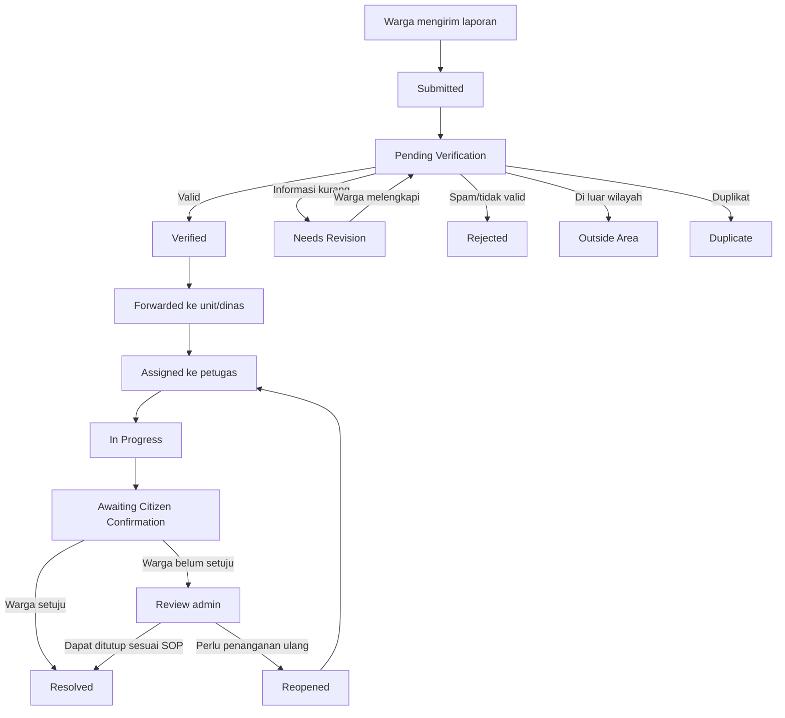
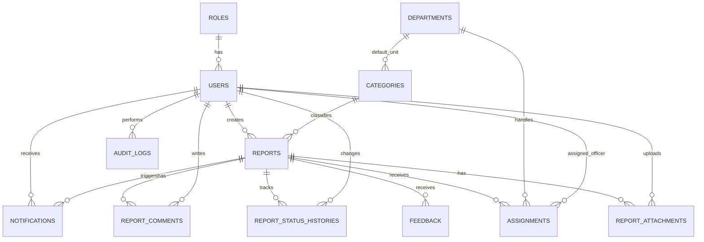

# PRODUCT REQUIREMENTS DOCUMENT (PRD)
## Smart Complaint – Sistem Pengaduan Masyarakat
### Kota Bandar Lampung

| Informasi Dokumen | Keterangan |
|---|---|
| Nama produk | Smart Complaint – Sistem Pengaduan Masyarakat |
| Wilayah implementasi | Kota Bandar Lampung |
| Platform | Aplikasi web responsif |
| Tujuan | Tugas kuliah dan demonstrasi prototipe |
| Versi dokumen | 1.0 |
| Status | Draft untuk peninjauan |
| Tanggal | 10 November 2026 |
| Teknologi target | Rust dan PostgreSQL/PostGIS |
| Pemilik dokumen | Zeindra Adi Verqiawan |

**Identitas visual pada cover**

<div align="center">

**[Logo Pemda Kota Bandar Lampung]**  
**[Logo Universitas Teknokrat Indonesia]**

# SMART COMPLAINT
## Sistem Pengaduan Masyarakat Kota Bandar Lampung

**PRODUCT REQUIREMENTS DOCUMENT (PRD)**

Disusun oleh: **Zeindra Adi Verqiawan**  
Dengan mencantumkan pembimbing/penanggung jawab: **Dr. Erliyan Redy Susanto, M.Kom**

</div>

> **Catatan aset branding:** placeholder logo di atas wajib diganti dengan file logo resmi. Penggunaan, proporsi, warna, ruang bebas, dan ukuran minimum harus mengikuti pedoman identitas visual masing-masing instansi. Pencantuman logo tidak dengan sendirinya menyatakan bahwa aplikasi merupakan kanal resmi Pemerintah Kota Bandar Lampung atau telah memperoleh persetujuan/kemitraan pemerintah.

**Footer wajib dokumen dan aplikasi:**

Copyright©2026 by Zeindra Adi Verqiawan dan Dr. Erliyan Redy Susanto, M.Kom

---

## 1. Halaman Cover dan Riwayat Revisi Dokumen

### 1.1 Riwayat revisi

| Versi | Tanggal | Perubahan | Penanggung jawab |
|---|---|---|---|
| 0.1 | 10-11-2026 | Penyusunan konsep, ruang lingkup, persona, dan kebutuhan awal | Zeindra Adi Verqiawan |
| 0.2 | 10-11-2026 | Penambahan validasi arsitektur Rust, PostgreSQL, dan PostGIS | Zeindra Adi Verqiawan |
| 1.0 | 10-11-2026 | Draft PRD terpadu untuk peninjauan | Zeindra Adi Verqiawan |

### 1.2 Konvensi requirement

- **FR**: Functional Requirement / kebutuhan fungsional.
- **NFR**: Non-Functional Requirement / kebutuhan non-fungsional.
- **BR**: Business Rule / aturan bisnis.
- **US**: User Story.
- **SEC**: kebutuhan keamanan dan privasi.
- **UI**: kebutuhan antarmuka dan identitas visual.
- **API**: kebutuhan antarmuka layanan.
- Prioritas menggunakan MoSCoW: **Must**, **Should**, **Could**, dan **Won't (untuk MVP)**.

### 1.3 Prinsip interpretasi dokumen

1. Produk ini adalah prototipe akademik untuk simulasi proses pengaduan publik.
2. Produk bukan kanal pengaduan resmi pemerintah dan tidak boleh mengklaim laporan telah diterima oleh dinas pemerintah tanpa integrasi dan persetujuan resmi.
3. Nama dinas, kewenangan penanganan, SLA, serta prosedur eskalasi yang dicontohkan harus divalidasi dengan struktur organisasi dan SOP Pemerintah Kota Bandar Lampung sebelum penggunaan operasional.
4. Data dashboard, akun petugas, dan laporan untuk demo dapat berupa data simulasi yang diberi label dengan jelas.

---

## 2. Ringkasan Eksekutif, Latar Belakang, Tujuan, dan Sasaran Terukur

### 2.1 Ringkasan eksekutif

Smart Complaint adalah aplikasi web responsif untuk membantu warga menyampaikan laporan mengenai permasalahan fasilitas umum dan lingkungan di wilayah Kota Bandar Lampung. Jenis laporan awal mencakup jalan rusak, lampu penerangan jalan umum (PJU) mati, sampah menumpuk, banjir/genangan, saluran drainase bermasalah, pohon tumbang, dan gangguan lingkungan lainnya.

Warga dapat membuat laporan dengan uraian, kategori, foto bukti, serta titik lokasi GPS atau pin pada peta. Admin melakukan pemeriksaan awal, menentukan kategori dan prioritas, kemudian meneruskan laporan kepada dinas/unit penanganan simulasi. Petugas lapangan memperbarui progres dan mengunggah bukti tindak lanjut. Warga dapat memantau status dan memberikan konfirmasi atau penilaian setelah laporan dinyatakan selesai.

Produk dirancang untuk web, dengan backend Rust dan basis data PostgreSQL yang dilengkapi PostGIS untuk kebutuhan geospasial. Tujuan utama proyek adalah menghasilkan prototipe akademik yang dapat didemonstrasikan, bukan langsung menggantikan sistem pengaduan resmi.

### 2.2 Latar belakang

Permasalahan fasilitas publik sering kali diketahui lebih dahulu oleh warga yang berada di lokasi. Tanpa kanal pelaporan yang terstruktur, informasi dapat tersebar melalui percakapan informal atau media sosial sehingga sulit ditelusuri, diprioritaskan, dan dievaluasi.

Sistem pengaduan terpusat dapat membantu:
- Menstandarkan informasi laporan.
- Menghubungkan laporan dengan lokasi yang jelas.
- Menyediakan nomor tiket dan riwayat status.
- Membantu admin memilah dan meneruskan laporan.
- Memudahkan petugas memperbarui progres.
- Menyediakan data ringkasan untuk evaluasi layanan.

Smart Complaint mengambil inspirasi dari pola umum layanan pengaduan publik, tetapi tidak mengklaim sebagai pengganti atau integrasi SP4N-LAPOR! maupun kanal resmi Pemkot Bandar Lampung.

### 2.3 Visi

Mewujudkan proses pelaporan permasalahan fasilitas umum yang lebih mudah, transparan, terdokumentasi, dan berbasis lokasi untuk mendukung peningkatan kualitas pelayanan publik di Kota Bandar Lampung.

### 2.4 Misi

1. Menyediakan kanal pelaporan berbasis web yang mudah digunakan.
2. Menyediakan bukti foto dan informasi lokasi yang terstruktur.
3. Membantu admin melakukan verifikasi dan distribusi laporan.
4. Memberikan visibilitas progres penanganan kepada warga.
5. Menyediakan data ringkasan untuk evaluasi dan pengambilan keputusan.

### 2.5 Tujuan produk

- Memungkinkan warga mengirim laporan dalam satu alur yang sederhana.
- Mengurangi laporan tanpa lokasi, kategori, atau bukti yang memadai.
- Memastikan setiap laporan memiliki nomor tiket dan riwayat status.
- Memudahkan admin menugaskan laporan kepada unit/petugas.
- Memungkinkan petugas mengunggah pembaruan dan bukti penanganan.
- Menyediakan dashboard operasional dan peta sebaran laporan.

### 2.6 Sasaran terukur MVP

Target berikut merupakan **target pengujian prototipe**, bukan klaim kinerja layanan pemerintah yang telah terukur.

| ID | Sasaran | Target MVP | Cara ukur |
|---|---|---:|---|
| KPI-01 | Keberhasilan pengiriman laporan | ≥95% dari percobaan valid | Log pengiriman berhasil dibanding percobaan valid |
| KPI-02 | Kelengkapan laporan | ≥90% laporan memiliki kategori, deskripsi, dan lokasi | Audit data laporan |
| KPI-03 | Laporan dapat dilacak | 100% laporan tersimpan memiliki nomor tiket | Pemeriksaan database |
| KPI-04 | Ketepatan distribusi simulasi | ≥85% laporan terverifikasi diarahkan ke unit yang sesuai | Review admin/dosen berdasarkan data uji |
| KPI-05 | Waktu respons sistem | p95 endpoint umum ≤2,5 detik pada beban demo yang disepakati | Pengujian performa |
| KPI-06 | Keamanan unggahan | 100% file uji berformat/ukuran tidak valid ditolak | Pengujian keamanan unggahan |
| KPI-07 | Kepuasan uji pengguna | Rata-rata ≥4 dari 5 | Kuesioner pengujian |
| KPI-08 | Konsistensi status | 100% perubahan status tercatat dalam riwayat | Audit status dan histori |

---

## 3. Ruang Lingkup dan Asumsi

### 3.1 In-scope MVP

1. Aplikasi web responsif untuk desktop dan perangkat seluler.
2. Registrasi/login warga.
3. Login admin dan petugas dengan hak akses berbasis peran.
4. Pembuatan laporan berisi judul, deskripsi, kategori, foto, dan lokasi.
5. Penentuan lokasi menggunakan GPS browser atau pin peta secara manual.
6. Nomor tiket unik untuk setiap laporan.
7. Verifikasi laporan oleh admin.
8. Penolakan laporan dengan alasan yang tercatat.
9. Penerusan laporan ke dinas/unit simulasi.
10. Penugasan kepada petugas lapangan.
11. Pembaruan status dan catatan penanganan.
12. Unggah bukti tindak lanjut.
13. Pelacakan status oleh warga.
14. Notifikasi di dalam aplikasi.
15. Dashboard ringkasan dan peta sebaran laporan.
16. Riwayat perubahan status dan aktivitas penting.
17. Ekspor ringkasan laporan ke PDF/CSV untuk kebutuhan demo.
18. Branding logo dan footer sesuai requirement khusus.

### 3.2 Out-of-scope MVP

- Integrasi langsung dengan sistem internal Pemkot Bandar Lampung atau SP4N-LAPOR!.
- Penjaminan bahwa laporan diproses oleh pemerintah sungguhan.
- Aplikasi native Android/iOS.
- Pembayaran atau kompensasi.
- Penentuan anggaran dan pengadaan pekerjaan.
- Integrasi otomatis dengan seluruh dinas.
- Klasifikasi laporan berbasis AI/ML.
- Chatbot generatif.
- Integrasi WhatsApp/SMS gateway berbayar.
- IoT sensor banjir, CCTV, atau sensor jalan.
- Prediksi kerusakan dan estimasi waktu penyelesaian berbasis AI.
- Peta offline penuh.
- Sistem tanggap darurat atau dispatch ambulans/pemadam.

### 3.3 Asumsi

| ID | Asumsi | Dampak/validasi |
|---|---|---|
| ASM-01 | Sistem dibuat sebagai prototipe akademik | Data dan akun demo dapat disimulasikan |
| ASM-02 | Wilayah uji adalah Kota Bandar Lampung | Batas administratif perlu data geospasial yang sah |
| ASM-03 | Warga memiliki browser modern dan koneksi internet sesekali | Form harus toleran terhadap jaringan lemah |
| ASM-04 | GPS browser hanya digunakan setelah izin pengguna | Pengguna tetap dapat memasang pin manual |
| ASM-05 | Admin menentukan dinas/unit tujuan berdasarkan kategori dan lokasi | Matriks kewenangan harus divalidasi |
| ASM-06 | Petugas menggunakan akun yang dibuat admin | Tidak ada pendaftaran petugas terbuka |
| ASM-07 | Logo resmi belum tersedia | Gunakan placeholder pada tahap desain |
| ASM-08 | Integrasi notifikasi eksternal belum menjadi kebutuhan MVP | Notifikasi internal lebih dahulu |
| ASM-09 | SLA pada prototipe adalah simulasi | Tidak boleh dipublikasikan sebagai janji resmi |
| ASM-10 | Satu pengembang/kelompok kecil mengerjakan MVP sekitar 12 minggu | Scope wajib dibatasi dan diuji bertahap |

---

## 4. Pemangku Kepentingan dan Persona Pengguna

### 4.1 Pemangku kepentingan

| Stakeholder | Kepentingan | Tanggung jawab/kontribusi |
|---|---|---|
| Warga/pelapor | Melaporkan masalah dan memantau progres | Mengirim informasi yang benar, bukti, dan lokasi |
| Petugas lapangan | Menerima dan menangani tugas | Memperbarui progres serta bukti penanganan |
| Admin dinas/operator | Memastikan laporan valid dan terdistribusi | Verifikasi, kategorisasi, penugasan, monitoring |
| Koordinator/pimpinan | Melihat ringkasan layanan | Memantau KPI dan laporan agregat |
| Tim pengembang | Menjaga sistem berjalan | Analisis, implementasi, pengujian, dokumentasi |
| Dosen/penguji | Menilai kesesuaian akademik | Memberi masukan dan memvalidasi demonstrasi |
| Pemilik identitas visual | Menjaga penggunaan logo | Menyediakan file dan pedoman resmi jika diizinkan |

### 4.2 Persona 1 – Warga

- **Tujuan:** melaporkan masalah publik dengan cepat dan mengetahui perkembangannya.
- **Kebutuhan:** form sederhana, unggah foto, GPS/peta, nomor tiket, status yang mudah dipahami.
- **Kendala:** koneksi internet tidak stabil, tidak memahami nama dinas, tidak ingin data pribadi tampil ke publik.
- **Kriteria keberhasilan:** laporan terkirim, lokasi benar, dan status dapat dipantau.

### 4.3 Persona 2 – Petugas lapangan

- **Tujuan:** melihat tugas yang diberikan dan melaporkan hasil pekerjaan.
- **Kebutuhan:** daftar tugas, detail lokasi, navigasi eksternal, tombol pembaruan status, unggah bukti.
- **Kendala:** penggunaan ponsel di lapangan, jaringan lemah, waktu input terbatas.
- **Kriteria keberhasilan:** dapat menemukan laporan, memperbarui progres, dan mengirim bukti dengan mudah.

### 4.4 Persona 3 – Admin dinas/operator

- **Tujuan:** mengelola antrean laporan dan memastikan laporan diarahkan ke unit yang tepat.
- **Kebutuhan:** filter, verifikasi, pengelolaan kategori, pemetaan dinas, penugasan, dashboard, audit trail.
- **Kendala:** laporan duplikat, informasi tidak lengkap, salah kategori, spam, dan ketidakjelasan kewenangan.
- **Kriteria keberhasilan:** laporan dapat diverifikasi dan didistribusikan dengan jejak aktivitas yang jelas.

### 4.5 Hak akses ringkas

| Fitur | Warga | Petugas | Admin |
|---|---:|---:|---:|
| Membuat laporan | Ya | Tidak | Ya, bila diperlukan untuk input operator |
| Melihat laporan milik sendiri | Ya | Tidak | Ya |
| Melihat tugas yang ditugaskan | Tidak | Ya | Ya |
| Verifikasi/menolak laporan | Tidak | Tidak | Ya |
| Menetapkan unit dan petugas | Tidak | Tidak | Ya |
| Memperbarui progres penanganan | Tidak | Ya | Ya |
| Konfirmasi/beri penilaian | Ya, untuk laporan sendiri | Tidak | Tidak |
| Mengelola kategori/unit/akun | Tidak | Tidak | Ya |
| Melihat dashboard agregat | Terbatas/publik | Terbatas | Ya |
| Melihat data pribadi pelapor | Data sendiri | Minimum sesuai tugas | Sesuai kebutuhan tugas dan kebijakan |

---

## 5. User Stories dan Acceptance Criteria

Format acceptance criteria menggunakan **Given–When–Then**.

### US-01 – Warga membuat laporan

**Sebagai** warga, **saya ingin** mengirim laporan kerusakan fasilitas umum agar masalah dapat dicatat dan ditindaklanjuti.

- **Given:** warga telah login dan membuka halaman buat laporan.
- **When:** warga mengisi kategori, judul, deskripsi, lokasi, lalu menekan tombol kirim.
- **Then:** sistem memvalidasi isian, menyimpan laporan, membuat nomor tiket unik, dan menampilkan halaman konfirmasi.

### US-02 – Warga melampirkan foto

- **Given:** warga berada di form laporan.
- **When:** warga mengunggah foto yang memenuhi format dan ukuran yang diizinkan.
- **Then:** sistem menyimpan file secara aman dan mengaitkannya dengan laporan.
- **And:** file yang tidak sesuai ditolak dengan pesan yang jelas.

### US-03 – Warga menentukan lokasi

- **Given:** browser mendukung geolocation.
- **When:** warga memberi izin GPS atau memilih titik pada peta.
- **Then:** sistem menyimpan koordinat dan menampilkan penanda lokasi.
- **And:** jika GPS ditolak/tidak tersedia, warga dapat memasukkan lokasi melalui pin manual.

### US-04 – Admin memverifikasi laporan

- **Given:** terdapat laporan berstatus menunggu verifikasi.
- **When:** admin memeriksa detail dan memilih verifikasi atau penolakan.
- **Then:** status berubah sesuai keputusan dan perubahan tercatat dalam riwayat.
- **And:** penolakan wajib memiliki alasan.

### US-05 – Admin meneruskan dan menugaskan laporan

- **Given:** laporan telah diverifikasi.
- **When:** admin memilih unit/dinas simulasi dan petugas yang tersedia.
- **Then:** sistem menyimpan penugasan, memperbarui status, dan membuat notifikasi kepada petugas.

### US-06 – Petugas memperbarui progres

- **Given:** petugas login dan memiliki penugasan aktif.
- **When:** petugas mengubah status serta menambahkan catatan/bukti.
- **Then:** sistem menyimpan pembaruan, mencatat aktor dan waktu, serta memberi notifikasi kepada warga.

### US-07 – Warga memantau dan mengonfirmasi

- **Given:** warga membuka detail laporan miliknya.
- **When:** warga melihat halaman pelacakan.
- **Then:** sistem menampilkan status terkini dan linimasa riwayat.
- **When:** laporan menunggu konfirmasi dan warga menyatakan selesai atau belum selesai.
- **Then:** sistem menyimpan tanggapan warga dan memperbarui status sesuai aturan.

### US-08 – Admin memantau dashboard

- **Given:** admin telah login.
- **When:** admin membuka dashboard dan memilih rentang tanggal/kategori.
- **Then:** sistem menampilkan jumlah laporan, status, kategori, dan sebaran lokasi sesuai filter.

---

## 6. Kebutuhan Fungsional

Prioritas: **Must** = wajib MVP; **Should** = penting jika waktu memungkinkan; **Could** = pengembangan tambahan; **Won't MVP** = tidak dikerjakan pada rilis pertama.

| ID | Fitur | Deskripsi | Prioritas | Acceptance criteria |
|---|---|---|---|---|
| FR-01 | Registrasi warga | Membuat akun warga dengan nama, email/nomor kontak, dan kata sandi | Must | Data valid menghasilkan akun; email/identitas unik |
| FR-02 | Login/logout | Autentikasi untuk semua peran | Must | Kredensial valid masuk; sesi/token dapat diakhiri |
| FR-03 | RBAC | Hak akses warga, petugas, dan admin | Must | Pengguna hanya dapat mengakses fungsi sesuai peran |
| FR-04 | Profil pengguna | Melihat dan memperbarui profil terbatas | Should | Perubahan tervalidasi dan tercatat |
| FR-05 | Form laporan | Mengisi judul, kategori, uraian, dan lokasi | Must | Laporan valid tersimpan dengan nomor tiket |
| FR-06 | Unggah foto | Melampirkan satu atau beberapa foto bukti | Must | File valid tersimpan; file berbahaya/invalid ditolak |
| FR-07 | GPS browser | Mengambil koordinat setelah izin pengguna | Must | Koordinat ditampilkan dan dapat dikonfirmasi |
| FR-08 | Pin peta manual | Memilih lokasi ketika GPS tidak tersedia | Must | Pin dapat dipindahkan dan koordinat tersimpan |
| FR-09 | Validasi wilayah | Memeriksa apakah koordinat berada di wilayah layanan | Must | Titik di luar wilayah diberi peringatan/ditandai untuk pemeriksaan |
| FR-10 | Nomor tiket | Membuat kode laporan yang unik dan mudah dibaca | Must | Setiap laporan memiliki kode unik |
| FR-11 | Daftar laporan warga | Menampilkan laporan milik pengguna | Must | Warga hanya melihat laporan miliknya kecuali data publik agregat |
| FR-12 | Detail laporan | Menampilkan uraian, kategori, foto, lokasi, dan status | Must | Informasi sesuai hak akses |
| FR-13 | Verifikasi admin | Admin menyetujui laporan yang valid | Must | Keputusan dan waktu tercatat |
| FR-14 | Penolakan laporan | Menolak spam, duplikat, atau laporan tidak valid | Must | Alasan penolakan wajib diisi |
| FR-15 | Kategorisasi | Mengelompokkan laporan berdasarkan jenis masalah | Must | Admin dapat memilih kategori yang tersedia |
| FR-16 | Pengelolaan unit/dinas | Mengelola daftar unit penanganan simulasi | Must | Admin dapat menambah/mengubah/menonaktifkan unit |
| FR-17 | Penerusan laporan | Meneruskan laporan terverifikasi ke unit tujuan | Must | Unit tujuan dan waktu penerusan tercatat |
| FR-18 | Penugasan petugas | Menetapkan petugas untuk laporan | Must | Petugas menerima tugas dan melihat detail yang diperlukan |
| FR-19 | Daftar tugas petugas | Menampilkan laporan yang ditugaskan | Must | Petugas hanya melihat tugas yang menjadi kewenangannya |
| FR-20 | Pembaruan status | Petugas mengubah status penanganan | Must | Transisi status divalidasi dan masuk histori |
| FR-21 | Catatan penanganan | Petugas menambahkan catatan tindakan | Must | Catatan tersimpan bersama aktor dan waktu |
| FR-22 | Bukti tindak lanjut | Petugas mengunggah foto hasil pekerjaan | Must | Foto terhubung dengan laporan dan penanganan |
| FR-23 | Riwayat status | Menyimpan semua perubahan status | Must | Histori tidak dapat diubah oleh warga |
| FR-24 | Pelacakan laporan | Warga melihat status dan linimasa | Must | Status terkini dan riwayat ditampilkan |
| FR-25 | Konfirmasi warga | Warga menyatakan selesai/belum selesai | Should | Tanggapan tercatat dan dapat memicu pemeriksaan ulang |
| FR-26 | Notifikasi internal | Memberi pemberitahuan saat status/penugasan berubah | Should | Notifikasi tersimpan dan dapat ditandai dibaca |
| FR-27 | Pencarian/filter | Filter berdasarkan status, kategori, tanggal, dan unit | Must | Hasil sesuai parameter filter |
| FR-28 | Dashboard admin | Menampilkan ringkasan laporan dan KPI | Must | Angka dashboard konsisten dengan data tersimpan |
| FR-29 | Peta sebaran | Menampilkan lokasi laporan yang diizinkan | Should | Marker mengikuti filter dan tidak membocorkan data pribadi |
| FR-30 | Deteksi kemungkinan duplikat | Menandai laporan serupa berdasarkan jarak/waktu/kategori | Could | Sistem memberi indikasi, admin tetap memutuskan |
| FR-31 | Ekspor laporan | Ekspor data terpilih ke PDF/CSV | Should | Hasil ekspor mengikuti filter dan hak akses |
| FR-32 | Komentar/tanggapan | Komunikasi tertulis terbatas antara warga dan admin | Could | Konten tersimpan dan dapat dimoderasi |
| FR-33 | Penilaian layanan | Warga memberi rating setelah selesai | Should | Satu penilaian per laporan sesuai aturan |
| FR-34 | Pengelolaan kategori | Admin mengatur kategori dan deskripsi | Must | Kategori aktif tersedia pada form |
| FR-35 | Pengelolaan akun | Admin mengaktifkan/menonaktifkan akun petugas | Must | Perubahan akses berlaku pada autentikasi berikutnya |
| FR-36 | Audit aktivitas | Mencatat aksi penting admin/petugas | Must | Aktor, aksi, waktu, dan objek tercatat |
| FR-37 | Status darurat | Menandai laporan yang membutuhkan perhatian segera | Must | Pesan peringatan dan instruksi kanal darurat ditampilkan |
| FR-38 | Penanganan laporan luar wilayah | Menandai laporan di luar batas area | Must | Laporan tidak otomatis diteruskan sebagai laporan dalam wilayah |
| FR-39 | Moderasi spam | Membatasi percobaan berulang dan menandai konten mencurigakan | Must | Rate limit dan mekanisme penolakan bekerja |
| FR-40 | Branding logo | Menampilkan placeholder/logo resmi Pemda dan UTI di cover, navbar, login/beranda, dan dokumen ekspor | Must | Semua lokasi yang ditetapkan menampilkan kedua logo dengan proporsi benar |
| FR-41 | Footer wajib | Menampilkan teks copyright persis di semua halaman web, layar utama mobile bila kelak ada, dan footer PRD | Must | Teks identik, tanpa perubahan karakter/ejaan/tanda baca, pada seluruh lokasi |
| FR-42 | Pengaturan batas unggahan | Mengatur ukuran, jumlah, dan format foto | Must | Batas diterapkan di frontend dan backend |
| FR-43 | Penghapusan/anonimisasi terkontrol | Mengelola permintaan penghapusan sesuai kebijakan dan kebutuhan audit | Should | Proses tercatat dan tidak menghapus histori wajib secara sembarangan |

### 6.1 Requirement branding terperinci

| ID | Requirement | Deskripsi dan penempatan | Ukuran/rasio | Prioritas | Acceptance criteria |
|---|---|---|---|---|---|
| UI-LOGO-01 | Logo Pemda | Placeholder `[Logo Pemda Kota Bandar Lampung]` pada cover PRD, navbar, halaman login, beranda, dan header PDF/hasil ekspor | Pertahankan rasio asli; tinggi tampilan web sekitar 36–48 px; cover/PDF sekitar 18–25 mm tinggi, menyesuaikan pedoman resmi | Must | Logo tampil di seluruh lokasi; tidak terdistorsi; file resmi digunakan setelah tersedia |
| UI-LOGO-02 | Logo Universitas Teknokrat Indonesia | Placeholder `[Logo Universitas Teknokrat Indonesia]` pada cover PRD, navbar, halaman login, beranda, dan header PDF/hasil ekspor | Pertahankan rasio asli; tinggi tampilan web sekitar 36–48 px; cover/PDF sekitar 18–25 mm tinggi, menyesuaikan pedoman resmi | Must | Logo tampil berdampingan/berpasangan dengan logo Pemda; tidak terdistorsi |
| UI-LOGO-03 | Pedoman aset logo | File logo harus resmi, resolusi memadai, dan digunakan sesuai pedoman identitas visual masing-masing instansi | SVG/PNG transparan lebih disarankan; tidak mengubah warna/proporsi tanpa izin | Must | Aset final disetujui/ditinjau sebelum rilis; placeholder tidak tertinggal pada rilis final |
| UI-FOOTER-01 | Footer copyright wajib | Teks wajib tampil pada semua halaman web, layar utama aplikasi mobile bila ada, dan footer dokumen PRD/ekspor yang relevan | Teks utuh, terbaca, tidak terpotong, ukuran konsisten dengan desain | Must | Teks yang tampil harus persis: `Copyright©2026 by Zeindra Adi Verqiawan dan Dr. Erliyan Redy Susanto, M.Kom` |
| UI-FOOTER-02 | Konsistensi footer | Footer menjadi komponen layout bersama agar tidak hilang pada halaman tertentu | Posisi bawah konten; pada halaman pendek berada di bagian bawah viewport, pada halaman panjang setelah konten | Must | Uji seluruh rute/halaman menunjukkan teks yang sama dan tidak ada variasi |

**Teks footer wajib — salin tanpa perubahan:**

Copyright©2026 by Zeindra Adi Verqiawan dan Dr. Erliyan Redy Susanto, M.Kom

---

## 7. Kebutuhan Non-Fungsional

| ID | Aspek | Requirement | Target/acceptance criteria |
|---|---|---|---|
| NFR-01 | Performa | Halaman dan API utama harus responsif pada beban prototipe | p95 ≤2,5 detik untuk endpoint umum pada skenario uji yang disepakati |
| NFR-02 | Performa unggahan | Sistem memvalidasi dan membatasi ukuran foto | Batas awal 5 MB/foto dan maksimal 5 foto/laporan; dapat dikonfigurasi |
| NFR-03 | Keamanan transport | Komunikasi produksi menggunakan HTTPS | Tidak ada kredensial/token dikirim melalui HTTP |
| NFR-04 | Password | Kata sandi disimpan menggunakan hashing adaptif | Argon2id atau algoritma setara; tidak menyimpan plaintext |
| NFR-05 | Otorisasi | Sistem menerapkan RBAC dan pemeriksaan kepemilikan objek | Pengguna tidak dapat membaca/mengubah laporan milik pihak lain tanpa kewenangan |
| NFR-06 | Validasi input | Semua input divalidasi di sisi server | Payload invalid ditolak dengan respons konsisten |
| NFR-07 | Proteksi unggahan | Memeriksa ekstensi, MIME, ukuran, dan signature file | File executable/script dan file yang tidak diizinkan ditolak |
| NFR-08 | Privasi pelapor | Data pribadi tidak ditampilkan pada halaman/peta publik | Peta publik hanya menampilkan data yang telah disamarkan/agregat |
| NFR-09 | Ketersediaan | Prototipe dapat diakses selama sesi demo | Target operasional demo ≥99% selama periode uji yang ditentukan; bukan SLA produksi |
| NFR-10 | Skalabilitas | Struktur dapat ditingkatkan tanpa mengubah domain inti | Pemisahan modul, indeks database, pagination, dan object storage |
| NFR-11 | Aksesibilitas | Form dapat digunakan dengan keyboard dan label yang jelas | Label input, kontras memadai, fokus terlihat, pesan error dapat dibaca |
| NFR-12 | Responsif | Antarmuka mendukung desktop, tablet, dan ponsel | Tidak ada overflow horizontal pada lebar layar umum |
| NFR-13 | Jaringan lemah | Form mempertahankan input sementara di browser dan memberi opsi coba ulang | Kegagalan jaringan tidak menghapus isian yang belum terkirim |
| NFR-14 | Offline terbatas | Pengguna dapat menyimpan draft lokal dan mengirim ulang saat online | Draft ditandai belum tersinkron; tidak mengklaim laporan telah terkirim |
| NFR-15 | Integritas data | Perubahan laporan/status dilakukan secara transaksional | Tidak ada status berubah tanpa histori yang sesuai |
| NFR-16 | Auditabilitas | Aksi penting memiliki jejak audit | Aktor, waktu, aksi, dan objek tersedia untuk admin berwenang |
| NFR-17 | Backup | Database memiliki prosedur backup dan restore | Prosedur diuji sebelum demo akhir |
| NFR-18 | Kompatibilitas | Mendukung browser modern | Chrome, Edge, Firefox, Safari versi yang masih didukung |
| NFR-19 | Maintainability | Kode memiliki struktur modular, dokumentasi, dan migrasi database | Developer lain dapat menjalankan proyek mengikuti README |
| NFR-20 | Lokalisasi | Bahasa antarmuka utama Bahasa Indonesia | Format tanggal/waktu dan pesan menggunakan Bahasa Indonesia |
| NFR-21 | Geospasial | Koordinat disimpan konsisten dan dapat diindeks spasial | PostGIS `geography(Point,4326)` atau `geometry(Point,4326)` dengan indeks GiST |
| NFR-22 | Logging | Error dan aktivitas sistem dicatat tanpa membocorkan rahasia | Password, token, dan data sensitif tidak ditulis ke log |
| NFR-23 | Retensi | Data disimpan sesuai kebijakan proyek dan tujuan akademik | Kebijakan retensi/anonimisasi ditentukan sebelum data nyata dipakai |

### 7.1 Kebijakan jaringan lemah dan offline

- Draft laporan dapat disimpan sementara di `IndexedDB` atau penyimpanan lokal browser.
- Draft lokal harus diberi label **Belum terkirim**.
- Foto dapat dikompresi di sisi klien sebelum unggah, tetapi validasi akhir tetap dilakukan backend.
- Ketika koneksi pulih, pengguna menekan tombol kirim ulang; MVP tidak boleh mengirim laporan diam-diam tanpa konfirmasi.
- GPS dapat gagal saat offline atau izin ditolak; sediakan pin manual jika peta telah termuat, atau input koordinat/alamat sederhana.
- Jangan mengunduh massal tile OpenStreetMap untuk penggunaan offline. Jika peta offline menjadi kebutuhan, gunakan penyedia/layanan tile yang secara eksplisit mengizinkan penggunaan tersebut.

---

## 8. Alur Kerja Laporan

### 8.1 Siklus status

1. `submitted` – laporan berhasil dikirim dan mendapat nomor tiket.
2. `pending_verification` – menunggu pemeriksaan admin.
3. `verified` – laporan dinyatakan valid.
4. `forwarded` – diteruskan ke unit/dinas simulasi.
5. `assigned` – petugas ditugaskan.
6. `in_progress` – penanganan sedang dilakukan.
7. `awaiting_citizen_confirmation` – petugas menyatakan pekerjaan selesai dan menunggu konfirmasi warga.
8. `resolved` – laporan selesai/ditutup.
9. `rejected` – laporan ditolak dengan alasan.
10. `needs_revision` – informasi perlu dilengkapi warga.
11. `outside_area` – laporan berada di luar wilayah layanan.
12. `duplicate` – laporan ditandai duplikat dan ditautkan ke tiket utama bila tersedia.
13. `reopened` – laporan dibuka kembali setelah warga menyatakan masalah belum selesai dan admin menyetujui pemeriksaan ulang.

### 8.2 Diagram alur status



### 8.3 Alur warga

1. Membuka aplikasi dan login.
2. Memilih **Buat Laporan**.
3. Mengisi judul, kategori, uraian, foto, dan lokasi.
4. Meninjau ringkasan sebelum mengirim.
5. Menerima nomor tiket.
6. Melihat daftar laporan dan detail status.
7. Menerima notifikasi saat status berubah.
8. Mengonfirmasi hasil atau meminta pemeriksaan ulang.

### 8.4 Alur admin

1. Membuka antrean laporan baru.
2. Memeriksa kelengkapan, bukti, kategori, dan titik lokasi.
3. Memeriksa indikasi spam/duplikat dan cakupan wilayah.
4. Meminta revisi, menolak, atau memverifikasi laporan.
5. Menentukan unit/dinas yang sesuai berdasarkan matriks kewenangan yang telah divalidasi.
6. Meneruskan dan menetapkan petugas.
7. Memantau progres hingga selesai.
8. Menutup laporan sesuai SOP simulasi dan menyimpan histori.

### 8.5 Alur petugas lapangan

1. Login.
2. Melihat tugas yang ditugaskan.
3. Membuka detail laporan dan lokasi.
4. Melakukan pemeriksaan/penanganan.
5. Memperbarui status dan catatan.
6. Mengunggah bukti tindak lanjut.
7. Menandai pekerjaan selesai untuk konfirmasi warga.

### 8.6 Skenario khusus

**Laporan palsu/spam**
- Terapkan rate limiting untuk pengiriman laporan dan login.
- Tandai pola berulang, konten tidak relevan, atau lampiran mencurigakan.
- Admin dapat menolak dengan alasan yang tercatat.
- Jangan otomatis memblokir warga hanya berdasarkan satu sinyal; sediakan pemeriksaan manusia.
- Simpan audit tindakan moderasi.

**Laporan di luar wilayah**
- Validasi titik terhadap poligon batas Kota Bandar Lampung yang sumbernya jelas.
- Jika di luar wilayah, tampilkan pemberitahuan sebelum pengiriman bila memungkinkan.
- Jika laporan tetap masuk, beri status `outside_area` atau antrean pemeriksaan admin.
- Jangan mengarahkan laporan ke dinas Kota Bandar Lampung seolah-olah menjadi kewenangannya.

**Laporan darurat**
- Beri penanda prioritas tinggi/kritis.
- Tampilkan peringatan bahwa aplikasi bukan layanan tanggap darurat.
- Arahkan pengguna menghubungi nomor/instansi darurat resmi yang telah diverifikasi dan diperbarui oleh pengelola.
- Admin dapat melakukan eskalasi manual pada simulasi.
- Jangan menjanjikan respons real-time atau dispatch petugas darurat.

**Laporan duplikat**
- Sistem dapat memberi peringatan berdasarkan kategori, kedekatan lokasi, dan rentang waktu.
- Admin memutuskan apakah laporan digabung/ditautkan.
- Laporan duplikat tetap memiliki jejak tiket agar pelapor dapat memahami hasilnya.

**Petugas tidak tersedia**
- Laporan tetap berada di antrean unit.
- Admin dapat mengganti petugas atau menunda penugasan dengan alasan.
- Dashboard menampilkan laporan yang belum memiliki petugas.

### 8.7 Aturan bisnis

| ID | Aturan |
|---|---|
| BR-01 | Setiap laporan memiliki ID internal dan nomor tiket unik. |
| BR-02 | Laporan warga wajib memiliki kategori, uraian, dan lokasi atau alasan lokasi tidak tersedia yang dapat ditinjau admin. |
| BR-03 | Foto bersifat opsional/diwajibkan sesuai kategori yang ditetapkan; untuk MVP disarankan minimal satu foto bila kondisi memungkinkan. |
| BR-04 | Warga hanya dapat mengubah laporan sebelum diverifikasi atau ketika admin meminta revisi. |
| BR-05 | Penolakan wajib memiliki alasan. |
| BR-06 | Hanya admin yang dapat memverifikasi dan meneruskan laporan. |
| BR-07 | Petugas hanya dapat memperbarui laporan yang ditugaskan kepadanya atau yang berada dalam kewenangan unitnya. |
| BR-08 | Setiap perubahan status harus menghasilkan record histori dalam transaksi yang sama. |
| BR-09 | Data pribadi pelapor tidak ditampilkan pada peta/halaman publik. |
| BR-10 | Status selesai dapat menunggu konfirmasi warga; jika tidak ada respons, admin dapat menutup berdasarkan SOP simulasi setelah periode yang ditentukan dan dengan bukti. |
| BR-11 | Laporan darurat tidak boleh dianggap telah ditangani hanya karena dibuat di aplikasi. |
| BR-12 | Penentuan dinas/unit mengikuti matriks kewenangan yang harus divalidasi, bukan asumsi pengembang. |
| BR-13 | Status terminal dan transisi status dibatasi oleh aturan backend, bukan hanya tampilan frontend. |
| BR-14 | Logo dan footer merupakan persyaratan lintas halaman dan tidak boleh dihilangkan pada tampilan responsif atau hasil ekspor. |

### 8.8 Contoh kategori awal dan unit penanganan simulasi

| Kategori | Contoh masalah | Unit penanganan simulasi (perlu validasi) |
|---|---|---|
| Jalan | Jalan berlubang, permukaan rusak | Unit pekerjaan umum/jalan |
| PJU | Lampu jalan mati/rusak | Unit penerangan jalan |
| Sampah | Sampah menumpuk, TPS bermasalah | Unit kebersihan/persampahan |
| Banjir/drainase | Genangan, saluran tersumbat | Unit drainase/sumber daya air |
| Pohon/lingkungan | Pohon tumbang, dahan berbahaya | Unit pertamanan/lingkungan |
| Fasilitas umum lain | Trotoar atau fasilitas publik rusak | Ditentukan admin setelah verifikasi |

---

## 9. Kebutuhan UI/UX

### 9.1 Prinsip desain

- Bahasa Indonesia yang sederhana dan konsisten.
- Mobile-first dan responsif.
- Form pelaporan bertahap agar tidak membebani pengguna.
- Status menggunakan label teks dan ikon, bukan warna saja.
- Peta mudah digunakan, tetapi input lokasi manual tetap tersedia.
- Data pribadi disembunyikan dari tampilan publik.
- Pesan error menjelaskan cara memperbaiki masalah.
- Logo tidak boleh mengganggu keterbacaan navbar.
- Footer wajib konsisten di semua halaman.

### 9.2 Daftar halaman utama

| Halaman | Pengguna | Konten utama |
|---|---|---|
| Beranda publik | Semua | Ringkasan layanan, cara melapor, kategori, tombol login/buat laporan, logo |
| Login | Semua peran | Form login, pemulihan akses sesuai cakupan MVP, logo |
| Registrasi | Warga | Form akun dan persetujuan kebijakan privasi |
| Dashboard warga | Warga | Ringkasan tiket dan laporan terakhir |
| Buat laporan | Warga | Form kategori, deskripsi, foto, GPS/peta |
| Daftar laporan saya | Warga | Tiket, tanggal, kategori, status |
| Detail/pelacakan | Warga | Detail laporan, linimasa, tanggapan, konfirmasi |
| Dashboard petugas | Petugas | Tugas baru, sedang berjalan, selesai |
| Detail tugas | Petugas | Uraian, foto, lokasi, catatan, pembaruan status |
| Dashboard admin | Admin | KPI, antrean, grafik, peta |
| Manajemen laporan | Admin | Filter, verifikasi, penolakan, penerusan |
| Detail/verifikasi | Admin | Bukti, lokasi, histori, tindakan admin |
| Manajemen petugas/unit | Admin | Akun, unit, penugasan |
| Manajemen kategori | Admin | Kategori dan status aktif |
| Pengaturan | Admin | Konfigurasi batas unggah, informasi layanan, footer/logo |
| Halaman cetak/ekspor | Admin | Header logo, informasi laporan, histori, footer |

### 9.3 Wireframe deskriptif

**A. Beranda publik**

```text
+------------------------------------------------------------------+
| [Logo Pemda] [Logo Universitas Teknokrat Indonesia]  Masuk       |
+------------------------------------------------------------------+
| SMART COMPLAINT                                                   |
| Sampaikan laporan fasilitas umum di Kota Bandar Lampung          |
| [Buat Laporan] [Lacak Laporan]                                    |
+------------------------------------------------------------------+
| Kategori: Jalan | PJU | Sampah | Banjir | Lingkungan              |
+------------------------------------------------------------------+
| Cara kerja: Buat laporan -> Verifikasi -> Penanganan -> Selesai   |
+------------------------------------------------------------------+
| Informasi layanan / statistik agregat / peta publik               |
+------------------------------------------------------------------+
| Copyright©2026 by Zeindra Adi Verqiawan dan Dr. Erliyan Redy       |
| Susanto, M.Kom                                                    |
+------------------------------------------------------------------+
```

**B. Form buat laporan**

```text
+------------------------------------------------------------------+
| [Logo Pemda] [Logo Universitas Teknokrat Indonesia]               |
+------------------------------------------------------------------+
| Buat Laporan                                                      |
| Judul [......................................................]    |
| Kategori [Pilih kategori v]                                       |
| Deskripsi [..................................................]    |
| Foto [Pilih file]                                                 |
| Lokasi [Gunakan GPS] [Pilih di peta]                              |
| Peta [                 pin lokasi                 ]               |
| [Simpan Draft]                              [Kirim Laporan]       |
+------------------------------------------------------------------+
| Footer copyright wajib                                            |
+------------------------------------------------------------------+
```

**C. Dashboard admin**

```text
+------------------------------------------------------------------+
| [Logo Pemda] [Logo Universitas Teknokrat Indonesia]  Admin        |
+------------------------------------------------------------------+
| Sidebar: Dashboard | Laporan | Petugas | Unit | Kategori          |
+------------------------------------------------------------------+
| Total | Menunggu Verifikasi | Diproses | Selesai                  |
+------------------------------------------------------------------+
| Grafik laporan per kategori       | Peta sebaran                  |
+------------------------------------------------------------------+
| Tabel antrean laporan dengan filter dan aksi                      |
+------------------------------------------------------------------+
| Footer copyright wajib                                            |
+------------------------------------------------------------------+
```

**D. Halaman detail petugas**

```text
+------------------------------------------------------------------+
| Detail Tugas #SC-2026-00001                                       |
| Kategori, uraian, foto, alamat/perkiraan lokasi                   |
| [Buka rute di aplikasi peta eksternal]                             |
| Status [Dalam proses v]                                           |
| Catatan penanganan [..........................................]   |
| Bukti foto [Pilih file]                                           |
| [Simpan Pembaruan]                                                |
+------------------------------------------------------------------+
| Footer copyright wajib                                            |
+------------------------------------------------------------------+
```

### 9.4 Penempatan logo dan footer

1. **Cover PRD:** kedua logo di area atas/tengah cover, sejajar, proporsi asli.
2. **Navbar web:** kedua logo di sisi kiri/area identitas aplikasi; pada layar sempit dapat disusun ringkas tetapi keduanya tetap tersedia.
3. **Login:** kedua logo di atas judul/form login.
4. **Beranda:** kedua logo berada di navbar/header utama.
5. **PDF/ekspor:** kedua logo di header dokumen; judul dan identitas laporan berada di bawahnya.
6. **Footer:** teks copyright persis ditampilkan pada semua halaman web dan seluruh dokumen PRD ini.
7. Jika aplikasi mobile dibuat kemudian, footer wajib muncul pada layar utama/layar navigasi utama dengan cara yang tidak menghalangi konten.

### 9.5 Pedoman visual awal

- Warna primer: biru tua/navy untuk kesan layanan publik dan keterpercayaan.
- Warna sekunder: biru terang untuk aksi utama.
- Latar: putih atau abu-abu sangat muda.
- Status: gunakan warna yang konsisten disertai teks, misalnya “Menunggu verifikasi”, “Diproses”, “Selesai”, dan “Ditolak”.
- Font: sans-serif yang mudah dibaca.
- Logo resmi tidak boleh diubah warna, dipotong, atau diregangkan.

---

## 10. Rancangan Data Awal

### 10.1 Entitas utama

| Entitas | Fungsi | Atribut kunci |
|---|---|---|
| users | Akun warga, petugas, admin | id, name, email, phone, password_hash, role_id, is_active |
| roles | Daftar peran | id, code, name |
| departments | Unit/dinas penanganan simulasi | id, name, description, is_active |
| categories | Kategori laporan | id, name, description, default_department_id |
| reports | Data utama pengaduan | id, ticket_number, reporter_id, category_id, title, description, location, status, priority |
| report_attachments | Foto bukti laporan/penanganan | id, report_id, uploaded_by, object_key, mime_type, size_bytes, attachment_type |
| assignments | Penugasan laporan | id, report_id, department_id, officer_id, assigned_by, assigned_at |
| report_status_histories | Riwayat status | id, report_id, old_status, new_status, changed_by, note, created_at |
| report_comments | Catatan/tanggapan | id, report_id, user_id, body, visibility |
| notifications | Notifikasi internal | id, user_id, report_id, title, body, read_at |
| feedback | Konfirmasi/rating warga | id, report_id, user_id, rating, comment |
| audit_logs | Jejak aktivitas penting | id, actor_id, action, entity_type, entity_id, metadata, created_at |

### 10.2 Relasi utama

- Satu `role` memiliki banyak `users`.
- Satu `user` warga dapat membuat banyak `reports`.
- Satu `category` dapat digunakan banyak `reports`.
- Satu `department` dapat menangani banyak `assignments`.
- Satu `report` memiliki banyak `report_attachments`.
- Satu `report` memiliki banyak `report_status_histories`.
- Satu `report` dapat memiliki beberapa `assignments` sepanjang proses eskalasi.
- Satu `user` petugas dapat menerima banyak `assignments`.
- Satu `report` dapat memiliki banyak `notifications` dan `comments`.
- Satu `report` dapat memiliki satu atau lebih catatan feedback sesuai kebijakan; MVP disarankan satu feedback final per warga/laporan.

### 10.3 Diagram ERD konseptual



---

## 11. Indikator Keberhasilan (KPI)

KPI operasional MVP mengacu pada target di bagian 2.6. Dashboard minimal menampilkan:

1. Total laporan masuk pada rentang tanggal.
2. Jumlah laporan menunggu verifikasi.
3. Jumlah laporan terverifikasi.
4. Jumlah laporan diteruskan/ditugaskan.
5. Jumlah laporan dalam proses.
6. Jumlah laporan selesai.
7. Jumlah laporan ditolak/di luar wilayah/duplikat.
8. Rata-rata waktu dari laporan dibuat hingga verifikasi.
9. Rata-rata waktu dari penugasan hingga pembaruan pertama.
10. Distribusi kategori.
11. Distribusi laporan berdasarkan kecamatan/kelurahan bila data batas wilayah tersedia.
12. Rating/feedback warga bila fitur diaktifkan.

**Ketentuan data KPI:**
- Data simulasi harus diberi label “Data Demo/Simulasi”.
- Jangan menyajikan angka target sebagai hasil nyata.
- Definisi rumus KPI harus konsisten. Contoh: tingkat penyelesaian = laporan berstatus `resolved` dibagi laporan valid yang telah masuk periode pengukuran.
- Dashboard publik hanya boleh menampilkan data agregat yang tidak mengidentifikasi pelapor.

---

## 12. Rencana Rilis Bertahap dan Estimasi Timeline

Estimasi dasar: 12 minggu, tim kecil/satu pengembang utama, dengan scope akademik dan layanan eksternal seminimal mungkin.

### 12.1 MVP – Minggu 1–12

| Minggu | Aktivitas | Output |
|---|---|---|
| 1 | Finalisasi kebutuhan, aktor, alur status, kategori | PRD final, daftar requirement |
| 2 | Use case, activity diagram, ERD, wireframe | Dokumen analisis dan rancangan |
| 3 | Setup repository, Rust toolchain, Axum, konfigurasi PostgreSQL | Kerangka backend berjalan |
| 4 | Migrasi, model data, autentikasi, RBAC | Login dan role dasar |
| 5 | API pembuatan laporan dan daftar/detail laporan | CRUD laporan |
| 6 | Unggah foto, validasi file, GPS dan peta | Form pelaporan lengkap |
| 7 | Verifikasi, penolakan, kategori, unit/dinas | Modul admin awal |
| 8 | Penugasan dan dashboard petugas | Modul penugasan |
| 9 | Pembaruan status, histori, notifikasi internal | Alur tindak lanjut |
| 10 | Dashboard KPI, peta sebaran, filter | Monitoring admin |
| 11 | Uji fungsional, keamanan dasar, responsif, perbaikan bug | Laporan pengujian |
| 12 | Deploy demo, dokumentasi, data simulasi, presentasi | Prototipe MVP |

### 12.2 Fase 2 – Penguatan layanan

Estimasi 1–2 bulan setelah MVP:
- Notifikasi email/WhatsApp melalui provider yang sah.
- Deteksi laporan duplikat berbasis jarak dan waktu.
- Heatmap laporan.
- Moderasi dan analisis laporan lebih lanjut.
- Ekspor laporan yang lebih lengkap.
- SLA per kategori/unit.
- PWA dengan kemampuan offline terbatas yang lebih matang.

### 12.3 Fase 3 – Integrasi dan kecerdasan

Estimasi 3–6 bulan atau sesuai kesiapan mitra:
- Integrasi resmi dengan sistem pemerintah setelah persetujuan dan spesifikasi tersedia.
- Klasifikasi kategori berbantuan AI dengan human review.
- Analitik tren dan prediksi.
- Integrasi kanal pengaduan lain.
- Aplikasi mobile native bila kebutuhan terbukti.
- Integrasi data spasial resmi dan sistem aset/fasilitas publik.

### 12.4 Kriteria rilis MVP

MVP dapat didemonstrasikan bila:
- Warga dapat membuat dan melacak laporan.
- Admin dapat memverifikasi, menolak, meneruskan, dan menugaskan laporan.
- Petugas dapat memperbarui status dan bukti.
- Semua perubahan status memiliki histori.
- Hak akses dan perlindungan data dasar berjalan.
- Peta menampilkan titik laporan dengan benar.
- Logo/placeholder dan footer wajib tampil pada seluruh lokasi.
- Dokumentasi instalasi, konfigurasi, migrasi, dan akun demo tersedia.

---

## 13. Risiko, Dependensi, dan Mitigasi

### 13.1 Risiko produk dan operasional

| ID | Risiko | Dampak | Mitigasi |
|---|---|---|---|
| RSK-01 | Kewenangan dinas tidak tervalidasi | Laporan salah diteruskan | Gunakan unit simulasi; validasi matriks kewenangan dengan sumber resmi |
| RSK-02 | Pengguna mengira aplikasi kanal resmi Pemda | Risiko reputasi dan salah ekspektasi | Tampilkan disclaimer prototipe akademik sampai ada persetujuan resmi |
| RSK-03 | Logo resmi belum tersedia/izin belum jelas | Branding tidak akurat | Gunakan placeholder; minta file dan pedoman resmi sebelum rilis final |
| RSK-04 | Laporan palsu/spam | Antrean admin terganggu | Rate limit, moderasi, alasan penolakan, audit trail |
| RSK-05 | Laporan darurat dianggap ditangani aplikasi | Risiko keselamatan | Disclaimer jelas dan rujukan ke kanal darurat resmi terverifikasi |
| RSK-06 | GPS tidak akurat/ditolak | Lokasi salah | Pin manual, konfirmasi lokasi, edit koordinat |
| RSK-07 | Koneksi internet lemah | Pengiriman gagal | Draft lokal, kompresi foto, retry dengan konfirmasi |
| RSK-08 | Data pribadi terekspos | Pelanggaran privasi | RBAC, minimisasi data, masking, HTTPS, audit akses |
| RSK-09 | Foto berisi konten sensitif | Risiko privasi | Panduan unggah, pembatasan akses, moderasi, retensi |
| RSK-10 | Timeline 12 minggu terlalu ketat | Fitur inti tidak selesai | Prioritaskan Must, tunda fitur Could, lakukan demo iteratif |
| RSK-11 | Data peta/batas wilayah tidak akurat | Validasi wilayah keliru | Gunakan sumber geospasial berlisensi/terpercaya dan verifikasi |
| RSK-12 | Ketergantungan layanan peta eksternal | Peta lambat/tidak tersedia | Abstraksikan provider peta, sediakan input koordinat manual |
| RSK-13 | Data dashboard simulasi disangka data nyata | Kesalahpahaman | Label data demo pada dashboard dan dokumen |
| RSK-14 | Belum ada SOP penyelesaian laporan | Status menggantung | Tetapkan SOP simulasi dan aturan penutupan yang transparan |

### 13.2 Dependensi

- File logo resmi dan pedoman identitas visual (jika penggunaan diizinkan).
- Data batas administratif Kota Bandar Lampung yang dapat digunakan.
- Daftar kategori dan pemetaan unit penanganan.
- Domain/hosting dan sertifikat HTTPS untuk demo publik.
- PostgreSQL dengan ekstensi PostGIS.
- Penyedia peta/tiles yang ketentuan penggunaannya dipatuhi.
- Object storage atau filesystem untuk foto.
- Akun demo dan data simulasi.
- Kebijakan privasi dan ketentuan penggunaan prototipe.

### 13.3 Referensi teknis awal

- Rust: https://www.rust-lang.org/
- Axum: https://docs.rs/axum/
- Tokio: https://tokio.rs/
- SQLx: https://docs.rs/sqlx/
- PostgreSQL: https://www.postgresql.org/docs/
- PostGIS: https://postgis.net/documentation/
- Leaflet: https://leafletjs.com/
- OpenStreetMap Tile Usage Policy: https://operations.osmfoundation.org/policies/tiles/
- Nominatim Usage Policy: https://operations.osmfoundation.org/policies/nominatim/
- SP4N-LAPOR!: https://www.lapor.go.id/

---

# BAGIAN II – VALIDASI KESESUAIAN TEKNOLOGI RUST DAN POSTGRESQL

## 14. Ringkasan Hasil Validasi

**Kesimpulan awal:** Rust + Axum + Tokio + SQLx + PostgreSQL/PostGIS sesuai untuk kebutuhan Smart Complaint. Stack ini mampu menangani API, autentikasi, unggahan foto, alur status, transaksi, pencarian, dan query geospasial. Kelayakan implementasi untuk tugas kuliah juga baik, tetapi kurva belajar Rust perlu diperhitungkan.

| Area | Penilaian | Catatan |
|---|---|---|
| Kebutuhan backend/API | Sesuai | Axum dan Tokio cocok untuk layanan HTTP asynchronous |
| Model data relasional | Sesuai | PostgreSQL mendukung constraint, transaksi, indeks, dan relasi |
| Lokasi GPS/peta | Sesuai | PostGIS menyediakan tipe geospasial dan indeks GiST |
| Autentikasi/RBAC | Sesuai, perlu implementasi disiplin | Gunakan session atau JWT, Argon2id, dan authorization middleware |
| Foto/lampiran | Sesuai | Simpan metadata di PostgreSQL dan file di object storage/filesystem |
| Background job/notifikasi | Perlu penyesuaian | Tambahkan worker dan antrean bila proses berkembang |
| Offline browser | Perlu penyesuaian | Ditangani frontend melalui PWA/IndexedDB, bukan fitur database/backend semata |
| Integrasi pemerintah | Belum dapat dinilai | Memerlukan API, izin, dan kesepakatan dari instansi terkait |

**Tingkat keyakinan kelayakan teknis: 8,5/10** untuk prototipe akademik. Nilai ini merupakan penilaian arsitektural, bukan hasil benchmark atau audit keamanan.

---

## 15. Pemetaan Requirement ke Rust/PostgreSQL

Status:
- **Sesuai:** dapat dipenuhi langsung dengan stack yang diusulkan.
- **Perlu penyesuaian:** dapat dipenuhi dengan komponen tambahan atau keputusan desain.
- **Tidak sesuai:** tidak tepat ditangani oleh Rust/PostgreSQL saja; memerlukan layanan/komponen lain.

### 15.1 Pemetaan kebutuhan fungsional

| Requirement | Solusi Rust/PostgreSQL | Status | Catatan |
|---|---|---|---|
| FR-01 Registrasi | Axum handler, Serde validation, SQLx insert, Argon2id | Sesuai | Verifikasi email dapat ditambahkan kemudian |
| FR-02 Login/logout | Session cookie atau JWT; penyimpanan sesi bila diperlukan | Sesuai | Pilih satu pendekatan untuk MVP |
| FR-03 RBAC | Middleware Axum dan tabel roles | Sesuai | Periksa hak akses pada setiap endpoint |
| FR-04 Profil | REST API + SQLx | Sesuai | Batasi field yang boleh diubah |
| FR-05 Form laporan | Axum + SQLx transaction | Sesuai | Validasi server-side wajib |
| FR-06 Foto | Multipart Axum, validasi file, MinIO/S3 atau filesystem | Perlu penyesuaian | File tidak disimpan sebagai BLOB utama di DB |
| FR-07 GPS | Frontend Geolocation API; backend simpan koordinat PostGIS | Sesuai | GPS memerlukan izin browser dan HTTPS |
| FR-08 Pin peta | Leaflet + API laporan | Sesuai | Tile peta bergantung provider |
| FR-09 Validasi wilayah | PostGIS `ST_Contains`/`ST_Covers` terhadap poligon | Sesuai | Perlu data batas wilayah valid |
| FR-10 Nomor tiket | PostgreSQL sequence/UUID + format kode | Sesuai | Jangan gunakan nomor berurutan sebagai satu-satunya kontrol keamanan |
| FR-11 Daftar warga | Query SQLx dengan filter `reporter_id` | Sesuai | Wajib cek ownership |
| FR-12 Detail laporan | Axum + query relasi | Sesuai | Redaksi data pribadi sesuai role |
| FR-13 Verifikasi | Update transaksional + histori | Sesuai | State transition harus divalidasi |
| FR-14 Penolakan | Update status + reason + histori | Sesuai | Alasan wajib |
| FR-15 Kategorisasi | Tabel categories dan FK | Sesuai | Kategori dapat diatur admin |
| FR-16 Unit/dinas | Tabel departments | Sesuai | Nama dan kewenangan harus divalidasi |
| FR-17 Penerusan | Tabel assignments/department | Sesuai | Histori penerusan disimpan |
| FR-18 Penugasan | SQLx transaction dan FK petugas | Sesuai | Validasi petugas aktif |
| FR-19 Daftar tugas | Query berdasarkan officer_id/unit_id | Sesuai | Hindari IDOR |
| FR-20 Pembaruan status | Transaction + status history | Sesuai | Terapkan state machine di domain/service layer |
| FR-21 Catatan | Tabel comments/notes | Sesuai | Atur visibilitas catatan internal/publik |
| FR-22 Bukti tindak lanjut | Multipart + object storage | Perlu penyesuaian | DB menyimpan metadata dan object key |
| FR-23 Riwayat status | Tabel append-only history | Sesuai | Batasi update/delete histori |
| FR-24 Pelacakan | Query status dan history | Sesuai | Hanya laporan milik warga |
| FR-25 Konfirmasi | Endpoint khusus + feedback table | Sesuai | Validasi status sebelum konfirmasi |
| FR-26 Notifikasi | Tabel notifications; worker untuk kanal eksternal | Perlu penyesuaian | In-app notification cukup untuk MVP |
| FR-27 Filter | SQL query, pagination, indeks | Sesuai | Hindari query tanpa batas |
| FR-28 Dashboard | Aggregate SQL dan endpoint statistik | Sesuai | Pertimbangkan materialized view jika data besar |
| FR-29 Peta | PostGIS + GeoJSON + Leaflet | Sesuai | Masking lokasi/identitas untuk data publik |
| FR-30 Duplikat | `ST_DWithin`, kategori, rentang waktu | Sesuai | Hanya indikasi; keputusan admin |
| FR-31 Ekspor | Rust PDF/CSV library atau layanan terpisah | Perlu penyesuaian | Uji dukungan font/logo dan layout PDF |
| FR-32 Komentar | Tabel comments + authorization | Sesuai | Moderasi diperlukan |
| FR-33 Rating | Tabel feedback | Sesuai | Constraint satu rating per laporan/pelapor |
| FR-34 Kategori | CRUD Axum + SQLx | Sesuai | Soft disable lebih aman daripada hapus |
| FR-35 Akun | CRUD users + audit log | Sesuai | Perubahan role dibatasi |
| FR-36 Audit | Tabel audit_logs + middleware/service | Sesuai | Hindari menyimpan token/password |
| FR-37 Darurat | Field priority/emergency + instruksi UI | Perlu penyesuaian | Informasi kontak darurat harus diverifikasi |
| FR-38 Luar wilayah | PostGIS polygon validation | Sesuai | Butuh dataset batas administrasi |
| FR-39 Spam | Rate limiter, unique constraints, moderation | Perlu penyesuaian | Gunakan Redis bila rate limit terdistribusi |
| FR-40 Logo | Frontend asset/static files dan template PDF | Sesuai | File logo resmi harus disediakan |
| FR-41 Footer | Shared layout component dan template dokumen | Sesuai | Uji semua route dan hasil ekspor |
| FR-42 Batas unggah | Multipart limit + MIME/signature validation | Sesuai | Validasi frontend tidak cukup |
| FR-43 Penghapusan/anonimisasi | SQL transaction, policy, audit | Perlu penyesuaian | Perlu kebijakan retensi dan dasar pemrosesan |

### 15.2 Pemetaan kebutuhan non-fungsional

| Requirement | Solusi | Status | Catatan |
|---|---|---|---|
| NFR-01 Performa | Tokio async, Axum, SQLx pool, indeks PostgreSQL | Sesuai | Benchmark tetap diperlukan |
| NFR-02 Unggahan | Multipart limit dan object storage | Sesuai | Kompresi dapat dilakukan frontend/worker |
| NFR-03 HTTPS | Reverse proxy Caddy/Nginx + TLS | Perlu penyesuaian | Bukan fitur database |
| NFR-04 Password | Argon2id crate | Sesuai | Parameter hashing diuji di server |
| NFR-05 RBAC | Middleware dan policy service | Sesuai | Uji akses horizontal/vertical |
| NFR-06 Validasi | Serde + validator/domain validation | Sesuai | Validasi tetap di backend |
| NFR-07 File | MIME sniffing, signature check, random key, antivirus opsional | Perlu penyesuaian | Jangan percaya nama/ekstensi file |
| NFR-08 Privasi | Column selection, policy, masking, role checks | Sesuai | Minimalkan data yang dikumpulkan |
| NFR-09 Ketersediaan | Health check, restart policy, monitoring | Perlu penyesuaian | Bergantung hosting |
| NFR-10 Skalabilitas | Stateless API, pool, indeks, object storage | Sesuai | Tambah worker/replica saat dibutuhkan |
| NFR-11 Aksesibilitas | HTML semantik, ARIA seperlunya, keyboard testing | Perlu penyesuaian | Tanggung jawab frontend dan QA |
| NFR-12 Responsif | Bootstrap/Tailwind dan CSS responsif | Perlu penyesuaian | Bukan kemampuan Rust |
| NFR-13 Jaringan lemah | Retry, kompresi, penyimpanan draft lokal | Perlu penyesuaian | Implementasi frontend |
| NFR-14 Offline terbatas | Service Worker + IndexedDB | Perlu penyesuaian | Hindari klaim sinkronisasi otomatis yang belum aman |
| NFR-15 Integritas | ACID transaction, FK, CHECK constraints | Sesuai | Gunakan transaksi untuk status + histori |
| NFR-16 Audit | audit_logs + append-only policy | Sesuai | Lindungi log dari perubahan tak sah |
| NFR-17 Backup | pg_dump/base backup dan uji restore | Perlu penyesuaian | Perlu operasi/infrastruktur |
| NFR-18 Browser | HTML/CSS/JS standar | Perlu penyesuaian | Uji lintas browser |
| NFR-19 Maintainability | Cargo workspace/modules, migrations, docs, tests | Sesuai | Terapkan format/lint/test |
| NFR-20 Bahasa | Resource frontend dan format tanggal | Sesuai | Gunakan locale Indonesia |
| NFR-21 Geospasial | PostGIS geography/geometry + GiST | Sesuai | Pilih SRID dan tipe secara konsisten |
| NFR-22 Logging | tracing + tracing-subscriber | Sesuai | Redaksi data sensitif |
| NFR-23 Retensi | Retention job dan kebijakan database | Perlu penyesuaian | Kebijakan harus ditetapkan |

---

## 16. Usulan Stack Teknologi

### 16.1 Stack yang direkomendasikan

| Lapisan | Teknologi | Alasan |
|---|---|---|
| Bahasa backend | Rust stable | Performa, keamanan memori, dan tipe yang kuat |
| HTTP framework | Axum | Integrasi baik dengan Tokio dan ekosistem Tower |
| Async runtime | Tokio | Runtime asynchronous untuk I/O |
| Serialization | Serde | Serialisasi/deserialisasi JSON |
| Database access | SQLx | Query SQL async, compile-time checking bila konfigurasi tersedia |
| Database | PostgreSQL | Relasional, transaksi, constraint, JSONB, indeks |
| Geospatial | PostGIS | Query jarak, containment, indeks spasial |
| Migration | SQLx migrate atau refinery | Versi skema database terkontrol |
| Authentication | Session cookie atau JWT | Pilih sesuai kebutuhan aplikasi |
| Password hashing | Argon2id | Hash kata sandi adaptif |
| Authorization | RBAC middleware/domain policy | Memisahkan hak akses dari handler |
| Frontend | HTML + Bootstrap 5 + JavaScript | Cepat untuk prototipe dan familiar |
| Peta | Leaflet + OpenStreetMap/provider tile sesuai kebijakan | Ringan dan mendukung GeoJSON |
| Grafik | Chart.js | Dashboard statistik |
| Foto | MinIO/S3-compatible | Memisahkan file dari database |
| Reverse proxy | Caddy atau Nginx | TLS, routing, static files |
| Logging | tracing + tracing-subscriber | Structured logging |
| Monitoring | Prometheus/Grafana (opsional) | Observabilitas saat sistem berkembang |
| Background job | Worker Rust + PostgreSQL job table atau Redis queue | Notifikasi dan proses asinkron |
| Deployment | Docker Compose untuk demo | Menyatukan API, DB, dan object storage |

### 16.2 Axum dibanding Actix-web

| Aspek | Axum | Actix-web |
|---|---|---|
| Integrasi Tokio/Tower | Sangat baik | Berbasis ekosistem Actix, dapat berjalan async |
| Gaya middleware | Tower layers | Actix middleware |
| Kurva belajar | Relatif mudah bagi pengguna ekosistem Tokio | Baik, tetapi model framework berbeda |
| Cocok untuk | API modular, integrasi Tower | API performa tinggi dan ekosistem Actix |
| Rekomendasi | **Pilihan utama** | Alternatif yang valid |

**Rekomendasi:** gunakan Axum agar komponen middleware, timeout, tracing, dan rate limiting dapat dibangun di atas Tower.

### 16.3 SQLx dibanding Diesel

| Aspek | SQLx | Diesel |
|---|---|---|
| Async | Native async | Diesel tradisional sinkron; tersedia pendekatan async melalui ekosistem terkait |
| Gaya query | SQL langsung dan macro | Query builder/type-safe ORM |
| Kontrol SQL | Tinggi | Abstraksi lebih tinggi |
| Cocok untuk PostGIS | Mudah menggunakan query SQL/PostGIS langsung | Dapat memakai SQL khusus untuk fitur tertentu |
| Rekomendasi | **Pilihan utama** | Alternatif bila tim menyukai ORM/query builder |

SQLx dipilih karena query PostGIS seperti `ST_DWithin`, `ST_Contains`, dan `ST_AsGeoJSON` dapat ditulis langsung tanpa memaksakan abstraksi ORM.

### 16.4 Autentikasi: session atau JWT

**Pilihan MVP yang disarankan: session cookie**
- Cocok untuk aplikasi web first-party.
- Cookie `HttpOnly`, `Secure`, dan `SameSite` mengurangi paparan token ke JavaScript.
- Perlu perlindungan CSRF untuk operasi yang mengubah data.
- Sesi dapat disimpan di PostgreSQL atau Redis.

**Alternatif: JWT**
- Cocok jika nantinya ada aplikasi mobile atau banyak client API.
- Gunakan access token berumur pendek dan refresh token yang dapat dicabut.
- Jangan menyimpan token sensitif di `localStorage` tanpa analisis risiko.
- Validasi signature, issuer, audience, expiry, dan rotasi kunci.

### 16.5 Penyimpanan foto

**Rekomendasi:** MinIO atau layanan S3-compatible.

- PostgreSQL menyimpan metadata file: object key, MIME type, ukuran, uploader, dan relasi laporan.
- File disimpan di object storage.
- Gunakan nama file acak, bukan nama asli sebagai object key.
- Validasi signature file, MIME, ukuran, dan dimensi gambar.
- Buat thumbnail/kompresi untuk tampilan peta/daftar.
- Akses file privat melalui endpoint berotorisasi atau signed URL berumur pendek.

**Alternatif prototipe:** filesystem lokal di luar direktori publik web. Pastikan backup file dan database dilakukan bersama agar relasi tidak rusak.

### 16.6 Frontend dan mobile

- **MVP:** server-rendered HTML atau frontend statis Bootstrap + JavaScript yang mengonsumsi REST API.
- **Alternatif frontend:** Vue atau React jika kompleksitas UI meningkat; tidak wajib untuk MVP.
- **Peta:** Leaflet dengan GeoJSON dari backend.
- **PWA:** Service Worker dan IndexedDB untuk draft/offline terbatas.
- **Mobile fase lanjut:** Flutter atau aplikasi native yang mengonsumsi API Rust yang sama.

### 16.7 Notifikasi, background job, logging

- **MVP:** notifikasi internal disimpan langsung di PostgreSQL.
- **Fase lanjut:** worker terpisah untuk email/WhatsApp, kompresi gambar, ekspor PDF, dan proses terjadwal.
- **Queue sederhana:** tabel `background_jobs` di PostgreSQL dapat digunakan pada skala prototipe.
- **Skala lebih tinggi:** Redis + worker atau message broker.
- **Logging:** `tracing` dan `tracing-subscriber`, dengan correlation/request ID.
- **Monitoring:** health endpoint, metrik request, error rate, pool database, dan kapasitas storage.

---

## 17. Skema Database PostgreSQL/PostGIS

### 17.1 Keputusan desain

1. Gunakan UUID sebagai primary key untuk entitas utama.
2. Gunakan `timestamptz` untuk waktu.
3. Gunakan `geography(Point,4326)` untuk query jarak dalam meter, atau `geometry(Point,4326)` bila operasi geometri planar/transformasi lebih dominan. Contoh di bawah menggunakan `geography`.
4. Simpan status sebagai `text` dengan `CHECK` constraint pada MVP; enum PostgreSQL dapat dipilih setelah daftar status stabil.
5. Simpan foto di object storage; database hanya menyimpan metadata.
6. Gunakan indeks GiST pada kolom lokasi.
7. Simpan riwayat status sebagai data append-only.
8. Semua perubahan status dan penambahan histori dilakukan dalam satu transaksi.

### 17.2 Tabel inti

| Tabel | Kolom penting | Kunci/indeks |
|---|---|---|
| roles | id, code, name | PK id, UNIQUE code |
| users | id, role_id, name, email, phone, password_hash, is_active, created_at | PK id, FK role_id, UNIQUE email |
| departments | id, name, description, is_active | PK id |
| categories | id, name, description, default_department_id, is_active | PK id, FK department |
| reports | id, ticket_number, reporter_id, category_id, title, description, location, address_text, status, priority, created_at, updated_at | PK id, UNIQUE ticket_number, FK, GiST location |
| report_attachments | id, report_id, uploaded_by, object_key, mime_type, size_bytes, attachment_type, created_at | PK id, FK report/user, UNIQUE object_key |
| assignments | id, report_id, department_id, officer_id, assigned_by, assigned_at, ended_at | PK id, FK |
| report_status_histories | id, report_id, old_status, new_status, changed_by, note, created_at | PK id, FK, index report_id+created_at |
| report_comments | id, report_id, user_id, body, visibility, created_at | PK id, FK |
| notifications | id, user_id, report_id, title, body, read_at, created_at | PK id, FK, index user_id+read_at |
| feedback | id, report_id, user_id, rating, comment, created_at | PK id, FK, UNIQUE report_id+user_id |
| audit_logs | id, actor_id, action, entity_type, entity_id, metadata, created_at | PK id, FK opsional, index entity dan waktu |

### 17.3 Contoh SQL DDL inti

> Contoh ini merupakan baseline untuk migrasi awal. Sesuaikan constraint, panjang kolom, dan kebijakan retensi sebelum deployment.

```sql
CREATE EXTENSION IF NOT EXISTS pgcrypto;
CREATE EXTENSION IF NOT EXISTS postgis;

CREATE TABLE roles (
    id          UUID PRIMARY KEY DEFAULT gen_random_uuid(),
    code        VARCHAR(30) NOT NULL UNIQUE,
    name        VARCHAR(80) NOT NULL
);

CREATE TABLE users (
    id              UUID PRIMARY KEY DEFAULT gen_random_uuid(),
    role_id         UUID NOT NULL REFERENCES roles(id),
    name            VARCHAR(150) NOT NULL,
    email           VARCHAR(255) NOT NULL UNIQUE,
    phone           VARCHAR(30),
    password_hash   TEXT NOT NULL,
    is_active       BOOLEAN NOT NULL DEFAULT TRUE,
    created_at      TIMESTAMPTZ NOT NULL DEFAULT NOW(),
    updated_at      TIMESTAMPTZ NOT NULL DEFAULT NOW()
);

CREATE TABLE departments (
    id          UUID PRIMARY KEY DEFAULT gen_random_uuid(),
    name        VARCHAR(160) NOT NULL,
    description TEXT,
    is_active   BOOLEAN NOT NULL DEFAULT TRUE,
    created_at  TIMESTAMPTZ NOT NULL DEFAULT NOW()
);

CREATE TABLE categories (
    id                      UUID PRIMARY KEY DEFAULT gen_random_uuid(),
    name                    VARCHAR(120) NOT NULL UNIQUE,
    description             TEXT,
    default_department_id   UUID REFERENCES departments(id),
    is_active               BOOLEAN NOT NULL DEFAULT TRUE,
    created_at              TIMESTAMPTZ NOT NULL DEFAULT NOW()
);

CREATE TABLE reports (
    id              UUID PRIMARY KEY DEFAULT gen_random_uuid(),
    ticket_number   VARCHAR(40) NOT NULL UNIQUE,
    reporter_id     UUID NOT NULL REFERENCES users(id),
    category_id     UUID NOT NULL REFERENCES categories(id),
    title           VARCHAR(180) NOT NULL,
    description     TEXT NOT NULL,
    location        GEOGRAPHY(POINT, 4326) NOT NULL,
    address_text    TEXT,
    status          VARCHAR(40) NOT NULL DEFAULT 'submitted',
    priority        VARCHAR(20) NOT NULL DEFAULT 'medium',
    is_emergency    BOOLEAN NOT NULL DEFAULT FALSE,
    created_at      TIMESTAMPTZ NOT NULL DEFAULT NOW(),
    updated_at      TIMESTAMPTZ NOT NULL DEFAULT NOW(),
    CONSTRAINT reports_status_check CHECK (
        status IN (
            'submitted', 'pending_verification', 'verified',
            'forwarded', 'assigned', 'in_progress',
            'awaiting_citizen_confirmation', 'resolved',
            'rejected', 'needs_revision', 'outside_area',
            'duplicate', 'reopened'
        )
    ),
    CONSTRAINT reports_priority_check CHECK (
        priority IN ('low', 'medium', 'high', 'critical')
    )
);

CREATE INDEX reports_location_gix
    ON reports USING GIST (location);

CREATE INDEX reports_status_created_idx
    ON reports (status, created_at DESC);

CREATE INDEX reports_reporter_created_idx
    ON reports (reporter_id, created_at DESC);

CREATE INDEX reports_category_created_idx
    ON reports (category_id, created_at DESC);

CREATE TABLE report_attachments (
    id              UUID PRIMARY KEY DEFAULT gen_random_uuid(),
    report_id       UUID NOT NULL REFERENCES reports(id) ON DELETE CASCADE,
    uploaded_by     UUID NOT NULL REFERENCES users(id),
    object_key      TEXT NOT NULL UNIQUE,
    original_name   TEXT,
    mime_type       VARCHAR(100) NOT NULL,
    size_bytes      BIGINT NOT NULL CHECK (size_bytes > 0),
    attachment_type VARCHAR(30) NOT NULL DEFAULT 'report',
    created_at      TIMESTAMPTZ NOT NULL DEFAULT NOW(),
    CONSTRAINT attachment_type_check CHECK (
        attachment_type IN ('report', 'resolution')
    )
);

CREATE INDEX report_attachments_report_idx
    ON report_attachments (report_id);

CREATE TABLE assignments (
    id              UUID PRIMARY KEY DEFAULT gen_random_uuid(),
    report_id       UUID NOT NULL REFERENCES reports(id),
    department_id   UUID NOT NULL REFERENCES departments(id),
    officer_id      UUID NOT NULL REFERENCES users(id),
    assigned_by     UUID NOT NULL REFERENCES users(id),
    assigned_at     TIMESTAMPTZ NOT NULL DEFAULT NOW(),
    ended_at        TIMESTAMPTZ
);

CREATE INDEX assignments_officer_active_idx
    ON assignments (officer_id, assigned_at DESC)
    WHERE ended_at IS NULL;

CREATE INDEX assignments_report_idx
    ON assignments (report_id, assigned_at DESC);

CREATE TABLE report_status_histories (
    id          UUID PRIMARY KEY DEFAULT gen_random_uuid(),
    report_id   UUID NOT NULL REFERENCES reports(id) ON DELETE CASCADE,
    old_status  VARCHAR(40),
    new_status  VARCHAR(40) NOT NULL,
    changed_by  UUID REFERENCES users(id),
    note        TEXT,
    created_at  TIMESTAMPTZ NOT NULL DEFAULT NOW()
);

CREATE INDEX report_history_timeline_idx
    ON report_status_histories (report_id, created_at ASC);

CREATE TABLE notifications (
    id          UUID PRIMARY KEY DEFAULT gen_random_uuid(),
    user_id     UUID NOT NULL REFERENCES users(id) ON DELETE CASCADE,
    report_id   UUID REFERENCES reports(id) ON DELETE SET NULL,
    title       VARCHAR(180) NOT NULL,
    body        TEXT NOT NULL,
    read_at     TIMESTAMPTZ,
    created_at  TIMESTAMPTZ NOT NULL DEFAULT NOW()
);

CREATE INDEX notifications_user_unread_idx
    ON notifications (user_id, created_at DESC)
    WHERE read_at IS NULL;

CREATE TABLE feedback (
    id          UUID PRIMARY KEY DEFAULT gen_random_uuid(),
    report_id   UUID NOT NULL REFERENCES reports(id),
    user_id     UUID NOT NULL REFERENCES users(id),
    rating      SMALLINT NOT NULL CHECK (rating BETWEEN 1 AND 5),
    comment     TEXT,
    created_at  TIMESTAMPTZ NOT NULL DEFAULT NOW(),
    UNIQUE (report_id, user_id)
);
```

### 17.4 Contoh query spasial

**Mencari laporan dalam radius 500 meter dari titik tertentu:**

```sql
SELECT
    id,
    ticket_number,
    title,
    status,
    ST_Distance(
        location,
        ST_SetSRID(ST_MakePoint(105.2668, -5.3971), 4326)::geography
    ) AS distance_m
FROM reports
WHERE ST_DWithin(
    location,
    ST_SetSRID(ST_MakePoint(105.2668, -5.3971), 4326)::geography,
    500
)
ORDER BY distance_m ASC;
```

Catatan: koordinat `105.2668, -5.3971` hanya contoh ilustratif dan bukan titik yang harus digunakan sebagai lokasi tetap.

**Memeriksa apakah titik berada di dalam poligon batas layanan:**

```sql
-- service_areas.geom diasumsikan bertipe geometry(MultiPolygon, 4326)
SELECT ST_Covers(
    geom,
    ST_SetSRID(ST_MakePoint(:longitude, :latitude), 4326)
) AS inside_service_area
FROM service_areas
WHERE code = 'BANDAR_LAMPUNG';
```

**Mendeteksi kemungkinan laporan duplikat dalam radius 100 meter, kategori sama, dan 7 hari terakhir:**

```sql
SELECT
    r.id,
    r.ticket_number,
    r.title,
    ST_Distance(r.location, :new_location::geography) AS distance_m
FROM reports r
WHERE r.category_id = :category_id
  AND r.created_at >= NOW() - INTERVAL '7 days'
  AND r.status NOT IN ('rejected', 'outside_area')
  AND ST_DWithin(r.location, :new_location::geography, 100)
ORDER BY distance_m ASC;
```

### 17.5 Catatan implementasi database

- Jalankan migrasi database melalui pipeline/deployment yang terkendali.
- Gunakan SQL parameterized melalui SQLx; jangan menyusun query dari input pengguna secara langsung.
- Gunakan pool koneksi dengan batas yang sesuai kapasitas hosting.
- Tambahkan pagination untuk daftar laporan.
- Gunakan `EXPLAIN ANALYZE` untuk memeriksa query yang lambat.
- Pertimbangkan partisi histori/audit hanya bila volume data sudah membenarkannya.
- Jangan menghapus histori status untuk sekadar merapikan data.
- Simpan koordinat dalam urutan longitude, latitude ketika membuat `ST_MakePoint(x,y)`.

---

## 18. Daftar Endpoint API Utama

Prefix API: `/api/v1`

| Metode | Path | Deskripsi | Akses |
|---|---|---|---|
| POST | `/auth/register` | Registrasi warga | Publik |
| POST | `/auth/login` | Login | Publik |
| POST | `/auth/logout` | Logout | Pengguna login |
| GET | `/auth/me` | Profil/sesi pengguna aktif | Pengguna login |
| GET | `/categories` | Daftar kategori aktif | Publik/login |
| GET | `/reports` | Daftar laporan sesuai role/filter | Warga (milik sendiri), petugas (tugas), admin (semua) |
| POST | `/reports` | Membuat laporan | Warga |
| GET | `/reports/{report_id}` | Detail laporan | Pemilik, petugas terkait, admin |
| PATCH | `/reports/{report_id}` | Mengubah laporan sebelum diverifikasi/ketika revisi | Pemilik sesuai status, admin |
| POST | `/reports/{report_id}/attachments` | Unggah lampiran | Pemilik/petugas terkait |
| GET | `/reports/{report_id}/history` | Riwayat status | Pemilik, petugas terkait, admin |
| POST | `/reports/{report_id}/verify` | Verifikasi laporan | Admin |
| POST | `/reports/{report_id}/reject` | Menolak laporan dengan alasan | Admin |
| POST | `/reports/{report_id}/request-revision` | Meminta kelengkapan | Admin |
| POST | `/reports/{report_id}/forward` | Meneruskan ke unit | Admin |
| POST | `/reports/{report_id}/assignments` | Menugaskan petugas | Admin |
| GET | `/officer/tasks` | Daftar tugas petugas aktif | Petugas |
| POST | `/reports/{report_id}/status` | Memperbarui status penanganan | Petugas terkait/admin |
| POST | `/reports/{report_id}/comments` | Menambahkan catatan/tanggapan | Pihak berwenang sesuai visibilitas |
| POST | `/reports/{report_id}/confirm` | Konfirmasi hasil oleh warga | Pemilik laporan |
| POST | `/reports/{report_id}/feedback` | Memberi rating/masukan | Pemilik laporan |
| GET | `/notifications` | Daftar notifikasi | Pengguna login |
| PATCH | `/notifications/{id}/read` | Menandai notifikasi dibaca | Pemilik notifikasi |
| GET | `/admin/dashboard` | KPI dan ringkasan | Admin |
| GET | `/admin/reports/map` | Data GeoJSON untuk peta | Admin; publik hanya endpoint agregat terpisah |
| GET | `/admin/departments` | Daftar unit | Admin |
| POST | `/admin/departments` | Membuat unit | Admin |
| PATCH | `/admin/departments/{id}` | Mengubah unit | Admin |
| GET | `/admin/users` | Daftar pengguna | Admin |
| PATCH | `/admin/users/{id}/role` | Mengubah peran | Admin berwenang |
| GET | `/admin/audit-logs` | Melihat audit log | Admin berwenang |
| GET | `/admin/reports/export` | Ekspor laporan terfilter | Admin |

### 18.1 Format respons API

Contoh sukses:

```json
{
  "data": {
    "ticket_number": "SC-2026-00001",
    "status": "submitted"
  },
  "message": "Laporan berhasil dikirim."
}
```

Contoh error validasi:

```json
{
  "error": {
    "code": "VALIDATION_ERROR",
    "message": "Periksa kembali data yang dikirim.",
    "details": {
      "title": "Judul wajib diisi."
    }
  }
}
```

Ketentuan:
- Gunakan HTTP status code yang tepat.
- Jangan mengirim stack trace kepada client.
- Gunakan pagination dengan `page` dan `per_page` atau cursor.
- Batasi ukuran request dan jumlah hasil.
- Endpoint sensitif harus memiliki autentikasi dan authorization check.
- Hindari membocorkan apakah email tertentu terdaftar melalui pesan login yang terlalu spesifik.

---

## 19. Analisis Risiko Teknis Rust dan PostgreSQL

| ID | Risiko teknis | Dampak | Mitigasi |
|---|---|---|---|
| TECH-01 | Kurva belajar Rust | Implementasi lebih lambat bagi tim yang belum terbiasa | Buat vertical slice lebih awal; pelajari ownership, borrowing, async, error handling secara bertahap |
| TECH-02 | Waktu kompilasi | Iterasi development terasa lambat | Gunakan incremental compilation, `cargo check`, cache build, dan hindari dependency berlebihan |
| TECH-03 | Library belum familiar | Waktu integrasi meningkat | Pilih crate populer dan terawat; pin versi; buat proof-of-concept upload/auth/PostGIS |
| TECH-04 | Integrasi SQLx/PostGIS | Mapping tipe spasial dapat memerlukan query SQL khusus | Gunakan SQL langsung, WKB/WKT atau GeoJSON; uji query PostGIS terpisah |
| TECH-05 | Deployment Rust | Hosting shared PHP biasa mungkin tidak mendukung binary Rust | Gunakan VPS/container atau platform yang mendukung binary/container |
| TECH-06 | Pengelolaan secrets | Kredensial database/token bocor | Environment variables/secret manager; jangan commit `.env` |
| TECH-07 | Konfigurasi pool DB | Pool terlalu besar menghabiskan koneksi | Atur `max_connections`, timeout, dan observasi pool |
| TECH-08 | Background jobs | Pekerjaan notifikasi menghambat request | Worker terpisah dan retry dengan batas |
| TECH-09 | File storage | File hilang atau object key tidak sinkron | Simpan metadata transaksional; backup object storage; proses kompensasi bila upload gagal |
| TECH-10 | Peta eksternal | Tile geocoding dibatasi atau berubah | Patuhi policy provider; abstraksikan provider; gunakan layanan berizin |
| TECH-11 | Query spasial berat | Dashboard lambat | GiST index, filter bounding box, pagination, dan analisis query |
| TECH-12 | Kurangnya pengujian keamanan | Akses data lintas pengguna | Uji IDOR, RBAC, CSRF/session, upload, rate limit, dan SQL injection |
| TECH-13 | Rust terlalu ambisius untuk tenggat | MVP tidak selesai | Batasi scope, gunakan Axum + SQLx, hindari microservices |
| TECH-14 | Kompilasi di hosting terbatas | Build gagal atau lambat | Build binary di CI/container builder lalu deploy artifact yang kompatibel |
| TECH-15 | Backup PostGIS | Pemulihan data spasial tidak teruji | Backup PostgreSQL dan uji restore termasuk extension/schema |

### 19.1 Rekomendasi deployment akademik

Untuk prototipe:
- Docker Compose untuk API Rust, PostgreSQL/PostGIS, dan MinIO.
- Caddy/Nginx sebagai reverse proxy.
- Frontend statis dapat disajikan dari reverse proxy atau backend.
- Gunakan volume persisten untuk database dan object storage.
- Sediakan `.env.example`, migration, seed data, dan README.
- Jangan expose port database ke internet publik.

---

## 20. Kebutuhan PRD yang Perlu Direvisi agar Selaras dengan Rust/PostgreSQL

| ID | Bagian PRD | Penyesuaian yang diperlukan | Alasan |
|---|---|---|---|
| REV-01 | Arsitektur | Tetapkan modular monolith Rust/Axum, bukan Laravel/PHP | Menyesuaikan target teknologi baru |
| REV-02 | Database | Gunakan PostgreSQL dan PostGIS, bukan MySQL | Dukungan geospasial dan constraint |
| REV-03 | Lokasi | Definisikan `geography(Point,4326)` dan sumber poligon batas | Query jarak dan validasi wilayah |
| REV-04 | Foto | Pisahkan object storage dari metadata database | Menghindari database membesar |
| REV-05 | Autentikasi | Putuskan session cookie atau JWT sebelum coding | Mempengaruhi middleware, CSRF, dan frontend |
| REV-06 | Status | Terapkan state machine dan histori transaksional | Menjaga konsistensi proses |
| REV-07 | Notifikasi | MVP menggunakan notifikasi internal; kanal eksternal fase berikutnya | Mengendalikan kompleksitas |
| REV-08 | Offline | Batasi pada draft lokal dan retry manual | Backend Rust/PostgreSQL tidak otomatis menyediakan offline |
| REV-09 | Peta | Pilih tile/geocoding provider dan patuhi ketentuan | OSM tile publik bukan layanan tanpa batas |
| REV-10 | Ekspor | Tentukan library PDF/CSV setelah proof-of-concept | Kebutuhan logo, font, dan layout dapat mempengaruhi pilihan |
| REV-11 | Hosting | Sediakan VPS/container yang mendukung binary Rust dan PostGIS | Shared hosting PHP mungkin tidak memadai |
| REV-12 | Monitoring | Tambahkan tracing, health check, dan backup | Menopang operasi aplikasi |
| REV-13 | Branding | Sediakan logo resmi dan template bersama untuk web/PDF | Memenuhi UI-LOGO-01 sampai UI-LOGO-03 |
| REV-14 | Footer | Buat satu komponen footer bersama dan template ekspor | Menjamin teks identik di semua halaman |
| REV-15 | SLA dan unit | Tandai sebagai simulasi sampai divalidasi pihak berwenang | Mencegah klaim layanan pemerintah yang tidak berdasar |

### 20.1 Keputusan arsitektur yang disarankan

- Gunakan **modular monolith**, bukan microservices.
- Pisahkan modul `auth`, `users`, `reports`, `attachments`, `assignments`, `workflow`, `notifications`, `dashboard`, dan `audit`.
- Pisahkan domain logic dari HTTP handler dan query database.
- Gunakan SQLx dan migration.
- Gunakan PostgreSQL/PostGIS sebagai sumber data utama.
- Gunakan object storage untuk foto.
- Gunakan worker hanya untuk tugas yang benar-benar perlu asynchronous/background.
- Frontend web responsif dapat memakai Bootstrap 5 dan Leaflet.

---

## 21. Checklist Kepatuhan Branding dan Footer

| ID | Checklist | Status desain | Bukti implementasi yang harus diuji |
|---|---|---|---|
| UI-LOGO-01 | Logo Pemda pada cover PRD | Tercakup – placeholder | Cover menampilkan `[Logo Pemda Kota Bandar Lampung]` |
| UI-LOGO-02 | Logo UTI pada cover PRD | Tercakup – placeholder | Cover menampilkan `[Logo Universitas Teknokrat Indonesia]` |
| UI-LOGO-03 | Kedua logo pada navbar | Wajib | Screenshot desktop dan mobile |
| UI-LOGO-04 | Kedua logo pada login | Wajib | Screenshot halaman login |
| UI-LOGO-05 | Kedua logo pada beranda | Wajib | Screenshot halaman beranda |
| UI-LOGO-06 | Kedua logo pada header PDF/ekspor | Wajib | Sampel file PDF/ekspor |
| UI-LOGO-07 | Rasio logo terjaga | Wajib | Pemeriksaan visual; tidak terdistorsi |
| UI-LOGO-08 | File resmi dan pedoman identitas visual digunakan | Menunggu aset resmi | Pemeriksaan sumber file dan persetujuan penggunaan |
| UI-FOOTER-01 | Footer tampil di semua halaman web | Wajib | Uji seluruh route/halaman |
| UI-FOOTER-02 | Footer tampil di layar utama mobile bila ada | Wajib saat aplikasi mobile dibuat | Screenshot layar utama |
| UI-FOOTER-03 | Footer tampil pada dokumen PRD | Tercakup | Bagian footer dokumen ini |
| UI-FOOTER-04 | Ejaan/tanda baca footer identik | Wajib | Bandingkan string secara persis |
| UI-FOOTER-05 | Footer tidak tertutup konten/responsive issue | Wajib | Uji viewport desktop dan mobile |

**String final yang wajib digunakan di seluruh implementasi:**

`Copyright©2026 by Zeindra Adi Verqiawan dan Dr. Erliyan Redy Susanto, M.Kom`

Checklist logo hanya dapat dinyatakan selesai secara visual setelah file resmi tersedia dan dipasang. Placeholder pada dokumen ini menunjukkan lokasi yang diwajibkan, bukan pengganti permanen aset resmi.

---

## 22. Kesimpulan Kelayakan

Smart Complaint layak dikembangkan sebagai prototipe akademik berbasis web dengan backend Rust dan PostgreSQL/PostGIS.

**Skor kelayakan teknis: 8,5/10 (keyakinan tinggi untuk prototipe akademik).**

Alasan:
1. Axum dan Tokio sesuai untuk membangun REST API asynchronous.
2. SQLx menyediakan akses PostgreSQL yang fleksibel dan mendukung query SQL eksplisit.
3. PostgreSQL/PostGIS sangat sesuai untuk menyimpan koordinat, pencarian radius, pemeriksaan batas wilayah, dan peta sebaran.
4. Object storage dapat menangani foto tanpa membebani database.
5. Frontend Bootstrap, Leaflet, dan Chart.js cukup untuk menghasilkan prototipe yang dapat didemonstrasikan.

Batasan utama:
- Tim perlu menguasai dasar Rust, async, ownership, dan error handling.
- Hosting harus mendukung binary/container Rust dan PostgreSQL dengan PostGIS.
- Data batas wilayah, pemetaan dinas, SLA, logo resmi, dan prosedur layanan perlu divalidasi.
- Integrasi pemerintah tidak termasuk MVP dan memerlukan persetujuan serta spesifikasi resmi.
- Skor kelayakan tidak menggantikan uji performa, keamanan, dan penerimaan pengguna.

**Rekomendasi akhir:** bangun MVP sebagai modular monolith menggunakan Rust + Axum + Tokio + SQLx + PostgreSQL/PostGIS, frontend Bootstrap 5 + Leaflet, dan MinIO/S3-compatible untuk foto. Prioritaskan alur laporan dari pembuatan hingga konfirmasi warga; tunda AI, integrasi eksternal, dan aplikasi native ke fase berikutnya.

---

## 23. Lampiran: Struktur Folder Proyek yang Disarankan

```text
smart-complaint/
├── backend/
│   ├── Cargo.toml
│   ├── .env.example
│   ├── migrations/
│   └── src/
│       ├── main.rs
│       ├── config/
│       ├── routes/
│       ├── middleware/
│       ├── modules/
│       │   ├── auth/
│       │   ├── users/
│       │   ├── reports/
│       │   ├── attachments/
│       │   ├── assignments/
│       │   ├── workflow/
│       │   ├── notifications/
│       │   ├── dashboard/
│       │   └── audit/
│       ├── database/
│       ├── errors/
│       └── utils/
├── frontend/
│   ├── assets/
│   │   ├── logos/
│   │   ├── css/
│   │   ├── js/
│   │   └── images/
│   ├── pages/
│   └── components/
│       ├── navbar
│       └── footer
├── infra/
│   ├── docker-compose.yml
│   └── reverse-proxy/
├── docs/
│   ├── PRD.md
│   ├── SRS.md
│   ├── USE-CASE.md
│   ├── ACTIVITY-DIAGRAM.md
│   ├── SEQUENCE-DIAGRAM.md
│   └── ERD.md
└── README.md
```

## 24. Langkah Lanjutan yang Direkomendasikan

1. Validasi requirement, terutama matriks kewenangan dinas, data batas wilayah, dan SOP status.
2. Finalisasi SRS dan diagram Use Case, Activity, Sequence, serta ERD.
3. Buat proof-of-concept Rust untuk autentikasi, CRUD laporan, upload foto, dan query PostGIS.
4. Buat wireframe final dan uji alur pelaporan pada perangkat seluler.
5. Implementasikan MVP secara iteratif dan lakukan pengujian keamanan serta penerimaan pengguna.

---

<div align="center">

**Dokumen Product Requirements Document (PRD)**  
**Smart Complaint – Sistem Pengaduan Masyarakat Kota Bandar Lampung**

Copyright©2026 by Zeindra Adi Verqiawan dan Dr. Erliyan Redy Susanto, M.Kom

</div>
